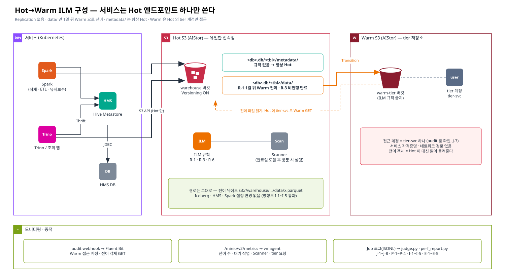
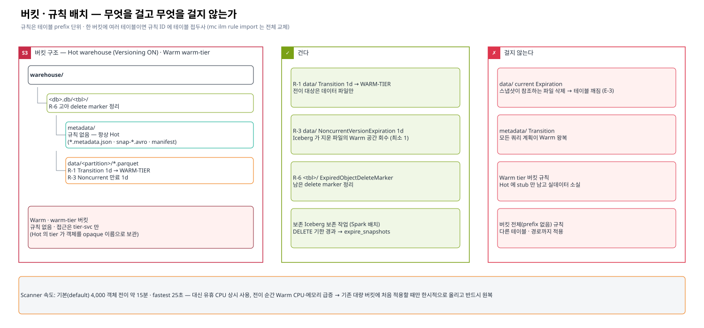
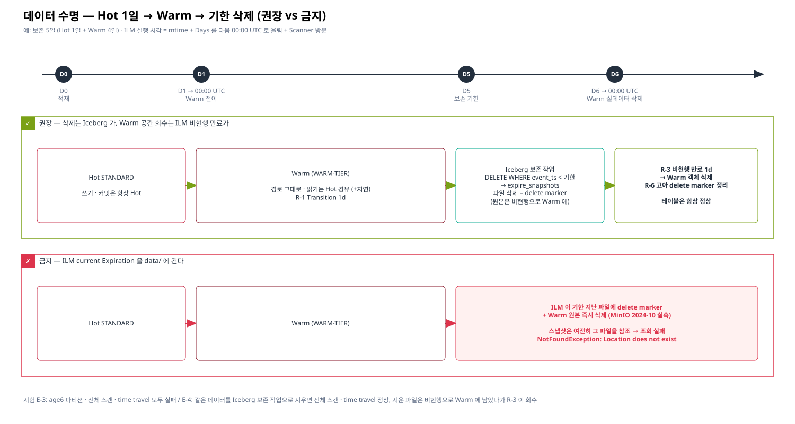

# 01. S3 버킷 · tier · ILM 구성 가이드 (운영 AIStor)

> 대상: Hot/Warm AIStor 를 운영하는 플랫폼 관리자
> 정책: **Hot 1일 → Warm**, 보존 기한이 지나면 삭제 (예: 5일 = Hot 1일 + Warm 4일) · Replication 없음 · 서비스는 Hot 엔드포인트만
> 근거 시험: [13장 결과](../13-ilm-hot-only-test/README.md#10-결과-기록표) — 기능 J-1~J-8 · 성능 P-1~P-4 · 영향도 I-1~I-5 · 기한 삭제 E-0~E-5
> 🔍 = 운영 AIStor 버전에서 다시 확인할 항목 (시험은 MinIO RELEASE.2024-10-13)



## 1. 한눈에 보기

| 대상 | 설정 | 값 |
|---|---|---|
| Hot 버킷 `warehouse` | Versioning | **ON** (Iceberg 실수 삭제 안전망 · R-3 전제) |
| | ILM R-1 | `<db>.db/<tbl>/data/` Transition **1일** → `WARM-TIER` |
| | ILM R-3 | `<db>.db/<tbl>/data/` NoncurrentVersionExpiration **1일** (최소 1) |
| | ILM R-6 | `<db>.db/<tbl>/` ExpiredObjectDeleteMarker |
| | `metadata/` | **규칙 없음** |
| | current Expiration | **걸지 않는다** — 기한 삭제는 Iceberg 보존 작업 (§6) |
| Hot tier | `WARM-TIER` | Warm `warm-tier` 버킷, Warm 의 tier 전용 계정 |
| Warm 버킷 `warm-tier` | ILM | **규칙 없음** (걸면 Hot 에 stub 만 남고 실데이터 소실) |
| | 접근 | tier 계정 하나만. 서비스 계정 · 서비스 네트워크 경로 없음 |
| Scanner | speed | `default` (대량 기존 버킷 첫 적용 때만 한시 상향 → 원복) |
| 감사 | audit webhook | Hot · Warm 둘 다 → 로그 수집 (Warm 접근 계정 감시) |



## 2. 계정 · 권한

| 계정 | 위치 | 권한 | 쓰는 곳 |
|---|---|---|---|
| 관리자 | Hot · Warm | admin | 설정 작업자만 (서비스에 배포 금지) |
| 서비스 계정 (예: `svc-iceberg`) | Hot | `warehouse` 버킷 RW | Spark · Trino · HMS |
| tier 계정 (예: `tier-svc`) | **Warm** | `warm-tier` 버킷 RW 만 | Hot 의 tier 설정 안에만 저장 |

```json
// Hot: 서비스 계정 정책 (버킷 한정)
{"Version":"2012-10-17","Statement":[{"Effect":"Allow","Action":["s3:*"],
  "Resource":["arn:aws:s3:::warehouse","arn:aws:s3:::warehouse/*"]}]}
// Warm: tier 계정 정책 (tier 버킷 한정)
{"Version":"2012-10-17","Statement":[{"Effect":"Allow","Action":["s3:*"],
  "Resource":["arn:aws:s3:::warm-tier","arn:aws:s3:::warm-tier/*"]}]}
```

- 서비스 계정에 `s3:PutLifecycleConfiguration` 이 필요 없다면 `s3:*` 대신 Get/Put/Delete/List 로 좁힌다 (규칙은 관리자만 바꾼다).
- 비밀값은 명령 인자 대신 stdin · Secret 으로만 넘긴다 (프로세스 목록 · 셸 이력 노출 방지).

## 3. 버킷 · tier 만들기

```bash
# mc alias: HOT / WARM 은 관리자 키 (작업 PC 또는 toolbox Pod)
mc mb --ignore-existing HOT/warehouse && mc version enable HOT/warehouse
mc mb --ignore-existing WARM/warm-tier                  # 🔍 Versioning 은 켜지 않는다 (tier 객체는 Hot 이 버전을 관리)

mc admin policy create WARM tier-rw tier-policy.json
mc admin user add WARM tier-svc            # 비밀키는 프롬프트/stdin
mc admin policy attach WARM tier-rw --user tier-svc

# Hot 에 remote tier 등록 (2024+ mc 는 `mc ilm tier`, 구버전은 `mc admin tier`)
mc ilm tier add minio HOT WARM-TIER --endpoint https://warm-s3.example.internal \
  --access-key tier-svc --secret-key "$TIER_SK" --bucket warm-tier [--prefix <구분용>/]
mc ilm tier ls HOT && mc ilm tier check HOT WARM-TIER   # 🔍 check 하위명령 지원 여부
```

## 4. ILM 규칙 적용

[`13-ilm-hot-only-test/scripts/00-apply-ilm.sh`](../13-ilm-hot-only-test/scripts/00-apply-ilm.sh) 를 그대로 쓴다.
기존 규칙 백업 → 규칙 생성(R-1/R-3/R-6) → 적용 → **위험 규칙 검사** → Warm 버킷 무규칙 확인 순서다.

```bash
cd 13-ilm-hot-only-test/scripts && cp config.env.example config.env && vi config.env
source config.env
export DB=sales TRANSITION_DAYS=1 NONCURRENT_EXPIRE_DAYS=1   # 테이블마다
MERGE=1 RULE_ID_PREFIX=sales- ./00-apply-ilm.sh --dry-run  # 미리보기
MERGE=1 RULE_ID_PREFIX=sales- ./00-apply-ilm.sh
```

생성되는 규칙 (테이블 `sales.db/orders` 예):

```json
{"Rules": [
  {"ID": "sales-r1-data-transition", "Status": "Enabled", "Filter": {"Prefix": "sales.db/orders/data/"},
   "Transition": {"Days": 1, "StorageClass": "WARM-TIER"}},
  {"ID": "sales-r3-data-noncurrent-expire", "Status": "Enabled", "Filter": {"Prefix": "sales.db/orders/data/"},
   "NoncurrentVersionExpiration": {"NoncurrentDays": 1}},
  {"ID": "sales-r6-expired-delete-marker", "Status": "Enabled", "Filter": {"Prefix": "sales.db/orders/"},
   "Expiration": {"ExpiredObjectDeleteMarker": true}}
]}
```

| 주의 | 이유 | 대응 |
|---|---|---|
| ★ `mc ilm rule import` 는 버킷 규칙 **전체 교체** | 테이블별로 따로 import 하면 앞 테이블 규칙이 사라진다 | `MERGE=1` (export → 같은 ID 만 교체) · `RULE_ID_PREFIX` 로 ID 충돌 방지 |
| prefix 는 S3 상 실제 테이블 경로 | HMS location 과 다르면 규칙이 아무것도 안 건드린다 (에러 없음) | `DESCRIBE TABLE EXTENDED` 의 Location 으로 확인 |
| 실행 시각 = `mtime + Days` → **다음 00:00 UTC** 올림 | 1일 규칙이라도 최대 2일 뒤 · 그 뒤 Scanner 방문 시 | `mc stat HOT/warehouse/<key>` 의 `Expiration`/전이 예정 확인 |
| 이미 기한 지난 객체는 규칙 적용 후 **Scanner 가 방문할 때** 일괄 처리 | 기존 버킷 첫 적용 시 대량 전이 | §7 Scanner · [13장 P-1](../13-ilm-hot-only-test/results/REPORT-perf-impact-20261026.md) |

확인:

```bash
mc ilm rule ls HOT/warehouse                       # 규칙
mc ilm rule export HOT/warehouse > backup.json     # 백업 (되돌리기 = import)
mc ls --recursive --versions --json HOT/warehouse/sales.db/orders/data/ | jq -r .storageClass | sort | uniq -c
mc stat HOT/warehouse/sales.db/orders/data/<file>  # Expiration · X-Amz-Storage-Class
```

## 5. 규칙을 걸지 않는 곳 (금지)

| 금지 | 결과 (시험) |
|---|---|
| `data/` current **Expiration** | 스냅샷이 참조하는 파일이 지워져 조회 실패 — `NotFoundException: Location does not exist` (E-3). 해당 파티션을 읽는 쿼리만 실패해 **늦게 · 부분적으로** 드러난다 |
| `metadata/` Transition | 모든 쿼리 계획이 Warm 왕복 |
| Warm tier 버킷 규칙 | Hot 에 stub 만 남고 실데이터 소실 |
| prefix 없는 버킷 전체 규칙 | 다른 테이블 · 경로까지 적용 |
| ExpiredObjectAllVersions | 버전 안전망 무력화 |

`00-apply-ilm.sh` 의 위험 규칙 검사가 위 항목이 버킷에 하나라도 있으면 실패한다.

## 6. 기한 삭제 — Iceberg 보존 작업 + ILM 비현행 만료



```sql
-- 매일 1회 (Spark). 보존 5일 예시 — 파티션 컬럼 기준으로 자르면 파일을 읽지 않고 메타데이터만 바뀐다
DELETE FROM hive_prod.sales.orders WHERE order_ts < current_timestamp() - INTERVAL 5 DAYS;
CALL hive_prod.system.expire_snapshots(table => 'sales.orders',
     older_than => current_timestamp() - INTERVAL 1 DAYS, retain_last => 5);
-- 선택: 실패한 쓰기의 고아 파일
CALL hive_prod.system.remove_orphan_files(table => 'sales.orders', older_than => current_timestamp() - INTERVAL 3 DAYS);
```

| 단계 | 누가 | 결과 |
|---|---|---|
| 보존 기한 경과 | Iceberg `DELETE` | 테이블에서 행 제거 (파티션 단위면 메타데이터만) |
| 스냅샷 만료 | Iceberg `expire_snapshots` | 파일 DELETE → Versioning ON 이므로 delete marker + 비현행 버전(Warm 에 그대로) |
| 비현행 1일 (→ 00:00 올림) | ILM R-3 | **Warm 객체 삭제** (공간 회수) |
| 그 다음 Scanner | ILM R-6 | 남은 delete marker 정리 |

- Warm 에서 데이터가 실제로 사라지는 시각 ≈ 보존 기한 + 보존 작업 주기 + 스냅샷 보존 + 비현행 1일(→ 00:00) + Scanner.
- Iceberg 가 아닌 prefix(원천 파일 등)는 `Expiration` 을 직접 걸어도 된다. 단 Versioning ON 버킷에서 **이미 Warm 으로 전이된 객체**가 만료되면 Warm 원본이 **즉시** 지워지고 비현행 버전 기록은 남지만 읽히지 않는다 (E-1, F-1) 🔍 — 버전 복구를 기대하지 않는다.

## 7. Scanner

| 상황 | 설정 | 시험 근거 |
|---|---|---|
| 평상시 | `mc admin config set HOT scanner speed=default` | 기존 4,000 객체 전이 914초 (4.5개/s, 단일 노드) |
| 대량 기존 버킷에 처음 적용 | 한시적으로 `fast`/`fastest` → 끝나면 `default` | `fastest` 25초. 대신 유휴에도 Hot CPU 82m 상시, 전이 순간 Warm CPU 380m · 메모리 990 Mi |

- 처리 시간 추정 = 대상 객체 수 ÷ 처리율. 운영 AIStor 의 처리율은 노드 · 드라이브 수에 비례하므로 **작은 테이블 하나로 먼저 재서** 추정한다 (`run-perf-impact.sh`).
- "규칙이 안 도는 것 같다"는 대부분 00:00 올림 + Scanner 대기다 — `mc stat` 의 예정 시각부터 본다.

## 8. 모니터링 · 감사

| 지표 / 로그 | 의미 | 경보 예 |
|---|---|---|
| `minio_node_ilm_transition_pending_tasks` · `active_tasks` | 전이 대기 · 진행 | 대기가 수 시간 줄지 않음 |
| `minio_node_ilm_transition_missed_immediate_tasks` | 즉시 전이 누락 | > 0 |
| `minio_node_tier_requests_failure{tier="WARM-TIER"}` | Hot → Warm 요청 실패 | 증가 |
| `minio_node_ilm_action_count_transition_action` | 전이 누적 (즉시값) | — |
| `minio_cluster_ilm_transitioned_{objects,bytes}` | 전이 누적 (Scanner 기준이라 늦다) | — |
| `minio_node_scanner_*` | Scanner 진행 | `bucket_scans_finished` 정체 |
| Warm audit log `accessKey` | Warm 접근 계정 | tier 계정 외 접근 1건이라도 |

수집 구성은 [13장 §5](../13-ilm-hot-only-test/README.md#5-모니터링--증적) · Fluent Bit 설정은 `13-ilm-hot-only-test/scripts/fluent-bit/` (http input 태그는 `-` → `_` 로 바뀐다, `queue_dir` 쓰지 않음).

## 9. 적용 체크리스트

| 시점 | 확인 |
|---|---|
| 적용 전 | 대상 테이블 Location = 규칙 prefix · 기존 규칙 백업 · tier 연결 확인 · 대상 객체 수 · Scanner 처리 시간 추정 |
| 적용 | `00-apply-ilm.sh --dry-run` → 적용 → 위험 규칙 검사 OK · Warm 무규칙 OK |
| 적용 후 1일 | `mc stat` 예정 시각 · storageClass 분포 · 전이 실패 0 · Warm audit = tier 계정만 |
| 매일 | Iceberg 보존 작업 성공 · noncurrent 수 추이 · Warm 사용량 추이 |
| 되돌리기 | 백업 JSON `mc ilm rule import` — 이미 전이된 객체는 Warm 에 남고 Hot 경유로 계속 읽힌다 (Hot 으로 되돌리려면 재기록 또는 restore 🔍) |

## 10. 운영 버전에서 다시 확인할 것 🔍

| 항목 | 시험 결과 (MinIO 2024-10) | 확인 방법 |
|---|---|---|
| 전이된 current 버전 만료 시 Warm 원본 즉시 삭제 (F-1) | 그렇다 — 비현행 기록은 남고 GET 은 NoSuchKey | `run-expiry.sh` E-1 |
| `X-Minio-Source-Mtime` 소급 | 동작 | `run-expiry.sh` E-0 (안 되면 실시간 일정) |
| 메트릭 이름 (v2) | 위 표 | `/minio/v2/metrics/cluster` · `node` (AIStor 는 v3 · 인증 토큰일 수 있음) |
| tier 명령 | `mc ilm tier` | AIStor `mc` 버전 |
| Warm tier 버킷 Versioning | OFF 로 시험 | AIStor 문서 |
