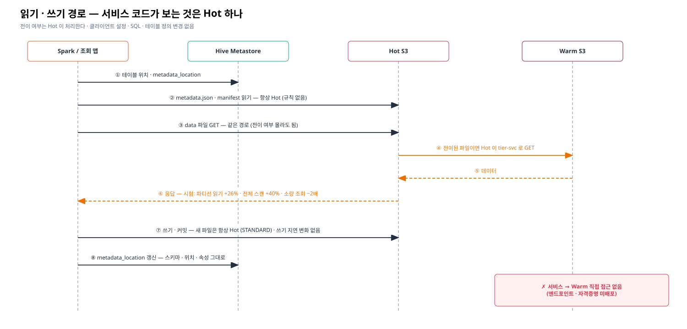

# 04. 서비스 개발자 안내 — Hot→Warm ILM 이 들어가면 무엇이 달라지나

> 대상: Spark · Trino · Iceberg 테이블을 쓰는 서비스 개발자
> 한 줄 요약: **코드 · 설정 · 테이블 정의는 그대로**다. 1일 지난 데이터 파일은 Warm 에 저장되고 Hot 을 거쳐 읽히므로 **오래된 데이터 조회가 조금 느려진다.**
> **데이터 삭제(보존 기한)는 Iceberg 작업으로** 한다 — S3 수명주기로 지우지 않는다.
> 그림 원본(draw.io): [`diagrams/`](./diagrams/) — Confluence 에는 *draw.io Diagram* 매크로 → *Import* 로 `.drawio` 를 올린다.

## 1. 구성


| 질문 | 답 |
|---|---|
| 접속 엔드포인트 | **Hot 하나** (지금과 같음). Warm 엔드포인트 · 자격증명은 받지 않는다 |
| 어떤 파일이 Warm 으로 가나 | 테이블의 `data/` 아래 Parquet 중 **만든 지 1일 지난 것** (정확히는 다음 00:00 UTC 이후 Scanner 가 지나갈 때) |
| 안 가는 것 | `metadata/` (metadata.json · manifest) — 쿼리 계획은 항상 Hot 에서 |
| 경로가 바뀌나 | 아니다. `s3://warehouse/…/data/x.parquet` 그대로. Iceberg 메타데이터도 그대로 |
| 테이블 정의 · HMS · Spark 설정 | 바뀌지 않는다 (시험 I-1 ~ I-5: 스키마 · 파티션 · 속성 · 위치 · 파일 경로 · HMS 정의 전후 동일) |

## 2. 읽기 · 쓰기에서 일어나는 일



- **쓰기 · 커밋**: 항상 Hot 에 새 파일을 쓴다. 전이와 무관하다 (시험: 전이 중에도 쓰기 p50 482 → 488 ms).
- **읽기**: Hot 에 요청하면, 파일이 Warm 에 있을 때 Hot 이 대신 가져와 준다. 응답은 같고 **지연만 늘어난다.**

| 시험 (단일 노드 테스트베드) | Hot 만 | Warm 경유 | 증가 |
|---|---|---|---|
| 작은 배치 1개 조회 | 291 ms | 590 ms | 약 2배 |
| 파티션 1개 (100 파일, 25 MB) | 755 ms | 951 ms | +26% |
| 전체 스캔 (4,000 파일, 1 GB) | 18.0 초 | 25.2 초 | +40% |

운영 AIStor 에서는 절대값이 다르다. 경향: **파일 수가 많을수록(요청 수) 상대 비용이 크다.**

## 3. 개발자가 할 일 · 하지 말 일

| 하세요 | 이유 |
|---|---|
| 오래된 데이터를 자주 읽는 배치는 **파티션 필터**를 걸어 필요한 파일만 읽기 | Warm 경유 요청 수가 곧 지연 |
| 작은 파일이 많은 테이블은 `rewrite_data_files` 로 compaction | 파일 수 ↓ → Warm 요청 ↓. 전이된 파일도 compaction 된다 (시험 J-6) |
| 보존 기한 삭제는 **Iceberg 보존 작업**으로 (§4) | 테이블이 깨지지 않는다 |
| 성능 비교 · 리포트 시 "데이터 나이" 를 같이 보기 | 1일 넘은 파티션은 Warm 경유 |

| 하지 마세요 | 이유 |
|---|---|
| S3 수명주기(Expiration)로 `data/` 지우기 요청 | 스냅샷이 참조하는 파일이 사라져 **해당 파티션 조회 · 전체 스캔 · time travel 이 실패**한다 (`NotFoundException: Location does not exist`). 다른 파티션 쿼리는 계속 성공해서 늦게 발견된다 (시험 E-3) |
| Warm 엔드포인트 · 자격증명 요청 · 직접 접근 | 전이 객체는 Warm 에서 이름이 바뀌어(opaque) 저장된다. 직접 읽을 수 없고 감사 경보 대상 |
| 테이블 위치를 다른 버킷/prefix 로 옮기기 (사전 협의 없이) | ILM 규칙은 테이블 prefix 단위 — 옮기면 규칙이 안 걸린다 |
| `metadata/` 를 다른 저장소로 분리하는 설정 변경 | 규칙 설계 전제와 어긋남 |

## 4. 데이터 수명과 삭제


보존 5일 (Hot 1일 + Warm 4일) 예:

```sql
-- 매일 1회. 파티션 컬럼 기준이면 파일을 읽지 않고 메타데이터만 바뀐다
DELETE FROM hive_prod.<db>.<tbl> WHERE <파티션 시간 컬럼> < current_timestamp() - INTERVAL 5 DAYS;
CALL hive_prod.system.expire_snapshots(table => '<db>.<tbl>',
     older_than => current_timestamp() - INTERVAL 1 DAYS, retain_last => 5);
```

| 단계 | 결과 |
|---|---|
| `DELETE` | 테이블에서 행이 사라진다 (조회 즉시 반영) |
| `expire_snapshots` | 옛 스냅샷이 쓰던 파일을 S3 에서 지운다 → 버킷 Versioning 때문에 **이전 버전**으로 남는다 |
| 1일 뒤 (→ 00:00 UTC) | ILM 이 이전 버전을 지운다 → **Warm 공간 회수** |

- time travel 은 `expire_snapshots` 가 남긴 스냅샷 범위 안에서만 된다 (ILM 과 무관).
- 법적 삭제 시한이 있다면 "보존 기한 + 작업 주기 + 스냅샷 보존 + 1~2일" 이 실제 Warm 삭제 시각이다.
- 보존 작업은 플랫폼 팀이 공통 배치로 돌릴 수도 있다 — 테이블별 보존 기한 · 파티션 컬럼만 알려 주면 된다.

## 5. 자주 묻는 질문

| 질문 | 답 |
|---|---|
| 쿼리가 갑자기 실패하면 ILM 탓인가? | ILM 전이로는 실패하지 않는다 (시험 전 기간 정합성 100%, 오류 0). `NotFoundException` 이면 누군가 수명주기 삭제를 걸었거나 파일을 직접 지운 것 — 플랫폼 팀에 문의 |
| 오래된 데이터 조회가 느리다 | 정상 범위인지 §2 표와 비교. 파일 수가 많으면 compaction 요청 |
| 어떤 파일이 Warm 에 있는지 알 수 있나? | 관리자 도구(`mc ls --json` 의 `storageClass`)로만. 서비스 코드에서 구분할 필요는 없다 |
| Warm 장애 때는? | 전이된(1일 지난) 파일을 읽는 쿼리만 실패한다. 최근 데이터 쓰기 · 읽기는 Hot 만 쓰므로 영향 없음 (🔍 운영 장애 시험 별도) |
| 새 테이블을 만들면 자동 적용되나? | 아니다. 규칙은 테이블 prefix 단위로 플랫폼 팀이 등록한다 — 테이블 생성 시 요청 |
| 스키마를 바꿔도 되나? | 된다. 전이된 파일 위에서 컬럼 추가 → 옛 파일은 null 로 읽히고 새 컬럼 쓰기 · 읽기 정상 (시험 I-4) |
| 전이를 끄면 데이터가 Hot 으로 돌아오나? | 아니다. 규칙을 지우면 새 전이만 멈춘다. 이미 Warm 에 있는 파일은 그대로 Hot 경유로 읽힌다 |

## 6. 그림 파일

| 그림 | draw.io | 미리보기 |
|---|---|---|
| 구성 (Hot 단일 접근) | [01-hot-only-architecture.drawio](./diagrams/01-hot-only-architecture.drawio) | [svg](./diagrams/01-hot-only-architecture.svg) |
| 데이터 수명 (권장 vs 금지) | [02-data-lifecycle.drawio](./diagrams/02-data-lifecycle.drawio) | [svg](./diagrams/02-data-lifecycle.svg) |
| 읽기 · 쓰기 경로 | [03-read-write-path.drawio](./diagrams/03-read-write-path.drawio) | [svg](./diagrams/03-read-write-path.svg) |
| 버킷 · 규칙 배치 | [04-bucket-rules.drawio](./diagrams/04-bucket-rules.drawio) | [svg](./diagrams/04-bucket-rules.svg) |

그림을 고치려면 `tools/gen_diagrams.py` 를 수정하고 `python3 tools/gen_diagrams.py` 로 다시 만든다 (`.drawio` · `.gliffy` · `.svg` 동시 생성).
