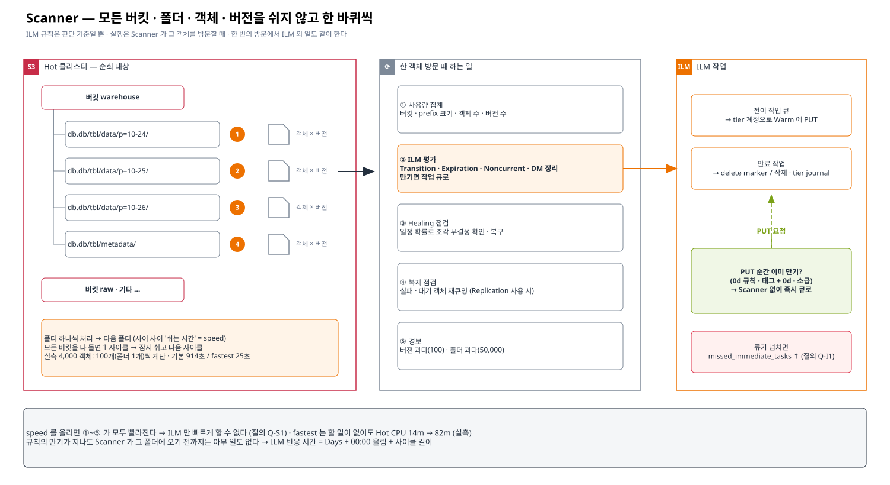
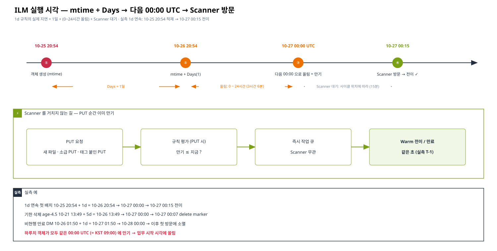

# 01. Scanner 동작 원리 — ILM 은 언제, 누가, 어떻게 실행하나

> 이 문서의 목표: "규칙을 걸었는데 왜 바로 안 되나", "Scanner 를 빨리 돌리면 왜 부하가 큰가" 를 스스로 설명할 수 있게 된다.
> 근거 표기: ✅ corp 테스트베드 실측 (MinIO RELEASE.2024-10-13) · 📘 MinIO 공개 문서 · 소스 기준 일반 동작 · ❓ AIStor 에서 확인할 것
> 관련: [02 부하 줄이기](./02-scanner-load-reduction.md) · [질의 Q-S1~S8](./06-question-guide.md#scanner)

---

## 1. 한 문장 정의

**Scanner 는 클러스터의 모든 버킷 · 폴더 · 객체 · 버전을 쉬지 않고 한 바퀴씩 순회하면서, 각 객체에 "지금 해야 할 일"이 있는지 확인하고 처리하는 백그라운드 작업이다.**

S3 수명주기(ILM) 규칙은 "시간이 되면 실행되는 예약 작업"이 아니다. 규칙은 **판단 기준**일 뿐이고, 실제로 판단하고 실행하는 주체는 Scanner 다.
즉, 규칙의 만기가 지나도 **Scanner 가 그 객체를 방문하기 전까지는 아무 일도 일어나지 않는다.**



## 2. Scanner 가 한 객체에서 하는 일

📘 MinIO 계열에서 Scanner 한 번의 방문은 ILM 만을 위한 것이 아니다. 같은 방문에서 여러 일을 함께 한다.

| 일 | 내용 | ILM 과의 관계 |
|---|---|---|
| ① 사용량 집계 | 버킷 · prefix 별 객체 수 · 크기 · 버전 수 · 크기 분포를 집계해 저장 (`mc du`, 사용량 메트릭, 쿼터의 기반) | 무관 — 그러나 같은 순회 비용을 공유 |
| ② ILM 평가 | 객체 · 버전마다 규칙(Transition · Expiration · Noncurrent · DM 정리)을 대조하고, 만기면 작업 큐에 넣는다 | **핵심** |
| ③ Healing 점검 | 일정 확률로 객체를 골라 erasure 조각 무결성을 확인 · 복구 | 무관 — 비용 공유 |
| ④ 복제 점검 | 복제가 실패 · 대기 중인 객체를 다시 큐에 넣음 (Replication 사용 시) | 복제와 ILM 이 같은 루프 |
| ⑤ 경보 | 한 객체의 버전이 너무 많거나(`alert_excess_versions`) 폴더 안 객체가 너무 많으면(`alert_excess_folders`) 경보 | 버전 폭증 조기 감지 |

✅ 테스트베드 설정 확인: `scanner speed=default alert_excess_versions=100 alert_excess_folders=50000`

→ **ILM 만 빠르게 하고 싶어도 Scanner 속도를 올리면 ①③④ 도 같이 빨라진다.** 이것이 "Scanner 를 자주 돌리면 부하가 크다" 의 본질이다. ❓ AIStor 에서 일부 작업만 분리 · 조절할 수 있는지 (Q-S1)

## 3. 순회 방식 — 폴더 단위, 사이클 단위

| 개념 | 설명 | 실측 / 근거 |
|---|---|---|
| 사이클(cycle) | 모든 버킷을 한 바퀴 도는 단위. 한 사이클이 끝나면 잠시 쉬었다가 다음 사이클 | 📘 |
| 폴더 단위 진행 | prefix(폴더) 하나를 처리하고 다음 폴더로. 폴더 사이 · 객체 사이에 "쉬는 시간" | ✅ 기존 4,000 객체 전이가 **100개(=파티션 폴더 하나)씩 계단**처럼 줄었다 |
| 부분 방문 | 한 사이클에 모든 폴더를 깊게 보지 않고, 변경이 없는 폴더는 건너뛰었다가 몇 사이클마다 전체를 다시 본다 (버전에 따라 방식 다름) | 📘 / ❓ Q-S3 |
| 분산 실행 | 여러 노드 · erasure set 이 나눠서 순회 | 📘 / ❓ Q-S8 — 노드를 늘리면 처리율이 늘어나는가 |

✅ 테스트베드 관측: 기본 속도에서 규칙 적용 후 13초 만에 첫 폴더가 처리됐지만, 4,000 객체(40 폴더) 전체는 **914초**(약 15분). 같은 양을 `fastest` 에서는 **25초**.
→ 한 버킷의 처리 시간은 "폴더 수 × 폴더당 처리 + 쉬는 시간" 으로 늘어난다. 운영 규모(수억 객체)에서 한 사이클이 며칠 걸릴 수 있다는 뜻이고, 그만큼 **ILM 반응이 늦어진다.**

## 4. ILM 실행 시각 — "1일 규칙 = 1일 뒤" 가 아니다



규칙 하나가 실제로 실행되기까지 세 단계가 겹친다.

```
① 만기 계산    due = mtime(객체 생성 시각) + Days
② 올림         due 를 다음 00:00 UTC 로 올린다          ← S3 수명주기 공통 규칙
③ 방문         due 이후 Scanner 가 그 객체를 방문할 때 실행
```

| 예 | mtime | + Days | 00:00 올림 | 실제 실행 (✅ 실측) |
|---|---|---|---|---|
| 1d 연속 첫 배치 | 10-25 20:54 | 10-26 20:54 | **10-27 00:00** | **10-27 00:15** (Scanner 방문) |
| 기한 삭제 age-4.5 | 10-21 13:49 | +5d = 10-26 13:49 | 10-27 00:00 | 10-27 00:07 (delete marker 시각) |
| 비현행 만료 (DM 10-26 01:50) | — | +1d = 10-27 01:50 | 10-28 00:00 | 10-28 00:00 이후 첫 방문 |

정리하면 **"N일 규칙" 의 실제 지연 = N일 + (0~24시간 올림) + (Scanner 가 그 폴더에 오기까지)**.
1일 규칙이 실제로는 1~2일 + α 가 되고, 하루치 데이터가 **모두 같은 00:00 UTC 에 만기**가 된다 (자정 쏠림).

`mc stat` 으로 객체별 예정 시각을 볼 수 있다:

```
$ mc stat HOT/ilm-age-test/obj/age-4.5
Expiration: 2026-10-27 00:00:00 UTC (lifecycle-rule-id: e1-transition)
```

## 5. Scanner 를 거치지 않는 길 — PUT 시점 즉시 처리

✅ 업로드(PUT) 순간에 규칙을 평가해서 **이미 만기**이면 Scanner 를 기다리지 않고 바로 처리한다.

| 상황 | 결과 (실측) |
|---|---|
| Transition **0d** 규칙 아래에서 새 파일 PUT | PUT 직후 전이 (`trace: ilm-src: s3PutObject`) |
| 과거 mtime 으로 소급 PUT (만기 이미 지남) | PUT 직후 전이 · 만료 |
| **태그 조건 + 0d** 규칙, 태그를 붙여 PUT | 같은 초에 전이 ([03 태그 기반 전이](./03-tag-based-tiering.md)) |
| 이미 있는 객체에 나중에 태그 (PutObjectTagging) | **즉시 처리 안 됨** — Scanner 방문까지 대기 |

이 "PUT 즉시 경로"가 Scanner 부하 문제를 우회하는 핵심 단서다 → [03](./03-tag-based-tiering.md).
즉시 처리는 내부 작업 큐로 넘어가고, 큐가 넘치면 놓친 건수가 `minio_node_ilm_transition_missed_immediate_tasks` 에 쌓인다 (❓ 넘친 건은 Scanner 가 다시 줍는지 — Q-I1).

## 6. 속도 설정 (`scanner speed`)

```bash
mc admin config get HOT scanner          # speed=default …
mc admin config set HOT scanner speed=slow
```

| 값 | 의미 (📘) | 관측 (✅ 단일 노드) |
|---|---|---|
| `fastest` | 쉬는 시간 없이 최대한 | 4,000 객체 25초 · **할 일이 없어도 Hot CPU 82m 상시** (default 14m) · 전이 순간 Warm CPU 380m · 메모리 990 Mi |
| `fast` | 쉬는 시간 짧게 | (미측정) |
| `default` | 기본 | 4,000 객체 914초 · 전이 중 Hot CPU +11% |
| `slow` · `slowest` | 쉬는 시간 길게 — 사용자 I/O 우선 | (미측정) |

- 속도는 **쉬는 시간의 비율**을 바꾸는 것이라, 할 일이 많을수록 차이가 커지고 할 일이 없어도 순회 자체의 비용이 남는다.
- ❓ 재시작 없이 즉시 반영되는지 · 노드별로 줄 수 있는지 · 시간대 스케줄 기능이 있는지 (Q-S4)

## 7. 관측 지표

| 지표 (v2 이름, ✅ 테스트베드) | 의미 |
|---|---|
| `minio_node_scanner_objects_scanned` · `versions_scanned` · `directories_scanned` | 누적 방문 수 — 기울기 = 순회 속도 |
| `minio_node_scanner_bucket_scans_started` · `bucket_scans_finished` | 버킷 순회 시작 · 완료 — 차이가 오래 남으면 큰 버킷에서 정체 |
| `minio_node_ilm_transition_pending_tasks` · `active_tasks` | 전이 대기 · 진행 |
| `minio_node_ilm_transition_missed_immediate_tasks` | 즉시 전이 큐에서 놓친 건 |
| `minio_node_ilm_action_count_transition_action` | 전이 누적 (즉시값) |
| `minio_cluster_ilm_transitioned_{objects,bytes}` | 전이 누적 (사용량 집계 기준이라 늦게 반영) |
| `minio_node_process_cpu_total_seconds` | Scanner 속도 변경 효과 |

❓ 사이클 한 바퀴 소요 시간 · 진행률을 직접 보여 주는 지표 (v3) 와 진단 명령 (Q-S6)

## 8. 기억할 것

1. ILM 규칙은 **기준**, 실행은 **Scanner 방문** — 방문이 늦으면 ILM 도 늦다.
2. 실행 시각 = mtime + Days → **다음 00:00 UTC** → 그 뒤 첫 방문. 하루치가 자정에 몰린다.
3. Scanner 속도는 ILM 만이 아니라 사용량 · healing · 복제 점검까지 함께 바꾼다 → 상시 가속은 비싸다.
4. **PUT 순간 만기인 객체는 Scanner 없이 처리된다** — 이 경로를 쓰면 Scanner 의존을 줄일 수 있다.
