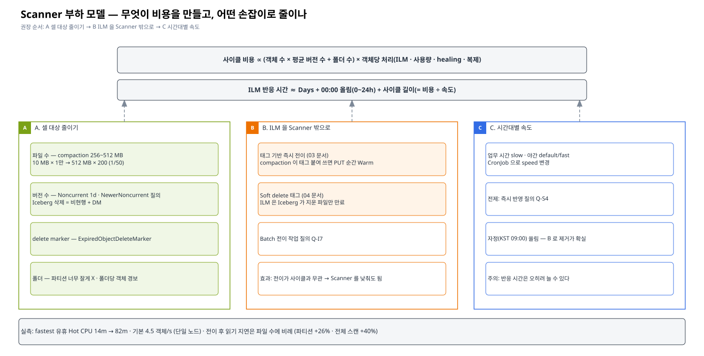
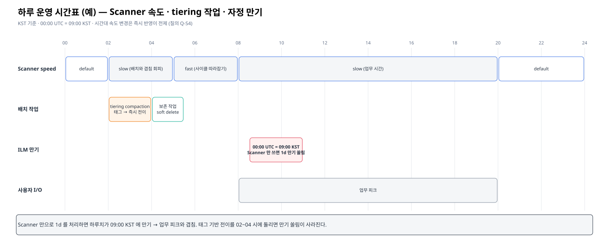

# 02. Scanner 부하 줄이기 — 무엇을 당기면 얼마나 줄어드나

> 이 문서의 목표: 대규모 클러스터에서 "Scanner 를 자주 · 빨리 돌릴 수 없다" 는 제약 아래, ILM 을 제때 돌리면서 부하를 줄이는 **손잡이(lever)** 를 이해하고 우선순위를 정한다.
> 선행: [01 Scanner 동작 원리](./01-scanner-internals.md) · 관련: [03 태그 기반 전이](./03-tag-based-tiering.md)

---

## 1. 비용 모델



Scanner 한 사이클의 비용과 ILM 반응 시간은 대략 이렇게 생각할 수 있다.

```
사이클 비용   ∝  (객체 수 × 평균 버전 수 + 폴더 수)  ×  객체당 처리 비용(ILM · 사용량 · healing · 복제 점검)
사이클 길이   ≈  사이클 비용 ÷ 처리 속도(speed · 노드 · 디스크)
ILM 반응 시간 ≈  Days  +  00:00 UTC 올림(0~24h)  +  사이클 길이(최악 한 바퀴)
```

그러므로 줄이는 방법은 세 갈래다.

| 갈래 | 손잡이 | 효과 | 부작용 |
|---|---|---|---|
| A. **셀 대상을 줄인다** | 파일 수 · 버전 수 · delete marker · 폴더 수 | 사이클 비용 자체가 준다 (모든 작업에 이득) | Iceberg 유지보수 작업 필요 |
| B. **ILM 을 Scanner 밖으로 뺀다** | PUT 즉시 경로 활용 (태그 기반 전이 · soft delete) | ILM 반응이 사이클 길이와 무관해진다 | 쓰기 1회 추가 · 엔진 설정 |
| C. **속도를 시간대별로** | `scanner speed` 를 업무 시간엔 낮게, 야간엔 기본 | 피크 시간 부하만 줄인다 | 반응 시간은 오히려 늘 수 있다 |

**권장 우선순위: A → B → C.** C 는 A · B 를 한 뒤 남은 부하를 시간대로 옮기는 용도다.

## 2. A — 셀 대상 줄이기

### 2-1. 파일 수 (Iceberg compaction)

| 항목 | 내용 |
|---|---|
| 왜 | Iceberg 스트리밍 · 마이크로배치 적재는 작은 파일을 대량으로 만든다. Scanner 비용 · Warm 경유 읽기 지연 모두 **파일 수**에 비례한다 (✅ P-3: 파일 100개 파티션 +26%, 1,000 MB 4,000 파일 전체 스캔 +40%) |
| 방법 | 매일 지난 파티션 `rewrite_data_files` — 목표 크기 256~512 MB |
| 효과 예 | 10 MB 파일 1만 개(100 GB) → 512 MB 200개 : Scanner 방문 대상 **50분의 1** |
| 주의 | 전이 전에 하는 것이 좋다 (전이 후 compaction 은 Warm 에서 읽어 Hot 에 다시 씀 — 동작은 ✅ J-6) → [03](./03-tag-based-tiering.md) 의 tiering compaction 과 합치면 한 번에 해결 |

```sql
CALL hive_prod.system.rewrite_data_files(
  table => 'db.tbl',
  where => "event_ts < current_date()",
  options => map('target-file-size-bytes', '536870912', 'min-input-files', '5'));
```

### 2-2. 버전 수 (Versioning × Iceberg)

Versioning ON 버킷에서 Iceberg 가 파일을 지우면 **객체가 사라지지 않고 비현행 버전 + delete marker** 가 된다. Scanner 는 이 버전들도 매번 본다.

| 버전이 늘어나는 원인 | 정리 방법 |
|---|---|
| `expire_snapshots` · compaction 으로 지운 파일 | `NoncurrentVersionExpiration` 1일 (최소값) |
| 같은 키 덮어쓰기 (Iceberg 는 거의 없음, version-hint 등 예외) | 같음 · ❓ `NewerNoncurrentVersions` |
| 비현행이 사라진 뒤 남는 delete marker | `ExpiredObjectDeleteMarker` |
| 실패한 쓰기의 고아 파일 | `remove_orphan_files` (주 1회 등) |

✅ E-5 실측: 비현행 1일 규칙 → 10-28 00:00 UTC 이후 비현행 · delete marker 모두 소멸.
감시: `alert_excess_versions`(기본 100) 경보 · `minio_node_scanner_versions_scanned` 와 `objects_scanned` 의 비율(평균 버전 수).

### 2-3. 폴더 수 · 폴더 크기

| 항목 | 내용 |
|---|---|
| Iceberg 파티션 = 폴더 | `hours()` 파티션은 하루 24 폴더 × 테이블 수. 너무 잘게 나누면 폴더 수가 늘고 파일이 작아진다 → `days()` 검토 |
| 한 폴더의 객체 수 | `alert_excess_folders`(기본 50,000) — 한 폴더에 수만 개면 그 폴더 처리 동안 다른 곳이 밀린다 |
| 버킷 분리 | ILM 이 필요한 테이블과 필요 없는 데이터를 버킷으로 나누면, ❓ 버킷 단위로 Scanner 우선순위 · 제외를 줄 수 있을 때 효과 (Q-S5) |

## 3. B — ILM 을 Scanner 밖으로

[03 태그 기반 전이](./03-tag-based-tiering.md) · [04 Iceberg soft delete](./04-iceberg-soft-delete.md) 에 자세히. 요점만:

- 전이: 매일 compaction 작업이 지난 파티션을 **태그 붙여 다시 쓰면** PUT 순간 Warm 으로 간다 (✅ T-1). Scanner 는 빠진 것만 줍는 안전망.
- 삭제: Iceberg 가 지울 파일에 **태그만 달고**, ILM 이 그 태그를 보고 만료 (✅ T-2) — 삭제 시점은 Scanner 의존이지만 **안전**해진다.
- 효과: 전이가 Scanner 사이클과 무관 → Scanner 를 `slow` 로 둬도 전이 지연이 늘지 않는다.

## 4. C — 시간대별 속도



| 시간대 (예, KST) | speed | 이유 |
|---|---|---|
| 08~20 (업무) | `slow` | 사용자 I/O 우선 |
| 20~02 | `default` | 일반 |
| 02~05 (tiering compaction · 보존 작업) | `slow` | 배치 작업 자체가 부하 — 겹치지 않게 |
| 05~08 (배치 끝난 뒤) | `fast` | 사이클 따라잡기 |

```yaml
# 예: 업무 시작 · 종료에 speed 변경 (toolbox 이미지 + 관리자 Secret)
apiVersion: batch/v1
kind: CronJob
metadata: { name: scanner-speed-day }
spec:
  schedule: "0 23 * * 0-4"          # UTC 23:00 = KST 08:00
  jobTemplate:
    spec:
      template:
        spec:
          restartPolicy: Never
          containers:
            - name: mc
              image: <registry>/mc
              command: ["mc", "admin", "config", "set", "HOT", "scanner", "speed=slow"]
              envFrom: [{ secretRef: { name: aistor-admin } }]   # MC_HOST_HOT
# scanner-speed-night: "0 11 * * *" (KST 20:00) → speed=default
```

❓ 변경이 즉시 반영되는지 · 진행 중 사이클이 영향을 받는지 · AIStor 에 공식 스케줄 기능이 있는지 (Q-S4). 반영되지 않으면 이 방법은 의미가 없다.

## 5. 자정 쏠림 다루기

1d 규칙에서 하루치 객체가 모두 같은 00:00 UTC (KST 09:00!) 에 만기가 된다.
→ **KST 업무 시작 시각에 전이 작업이 몰린다.**

| 방법 | 효과 |
|---|---|
| B(태그 기반 전이) 로 전이를 야간 배치 시간에 | 쏠림 제거 (가장 확실) |
| 테이블별 Days 를 1 · 2 로 나눔 | 이틀로 분산 |
| 00:00 UTC 전후로 Scanner `slow` | 쏠림을 길게 펴서 피크를 낮춤 (반응은 늦어짐) |
| ❓ 올림 기준 시간대를 바꾸는 옵션 | Q-I4 |

## 6. 의사결정 표

| 우리 상황 | 먼저 할 것 |
|---|---|
| 작은 파일이 많다 (평균 < 64 MB) | A-파일 수 (compaction) |
| `versions_scanned / objects_scanned` > 2 | A-버전 수 (비현행 · DM 정리) |
| 사이클이 하루 이상 걸린다 | B (전이를 Scanner 밖으로) |
| 업무 시간 지연이 문제다 | C (시간대 속도) + B |
| 기존 대량 버킷에 처음 규칙을 건다 | 한시 `fast` + 진행 모니터링 → 원복 ([13장 P-1](../13-ilm-hot-only-test/results/REPORT-perf-impact-20261026.md)) |
