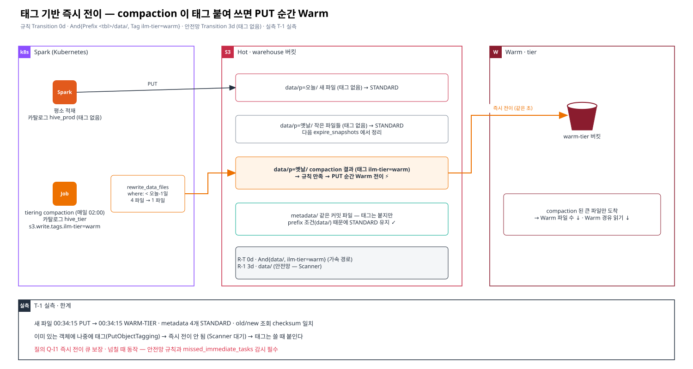

# 03. 태그 기반 즉시 전이 — Scanner 를 기다리지 않는 Hot→Warm

> 이 문서의 목표: "태그 붙여 다시 쓰면 바로 Warm 으로 간다" 는 제안이 **왜 동작하고, 어디까지 믿을 수 있고, 운영에 어떻게 넣는지** 이해한다.
> 근거: ✅ T-1 실측 (2026-10-28, corp 테스트베드 · Iceberg 1.9.0 · MinIO 2024-10) — 스크립트 `13-ilm-hot-only-test/scripts/spark/tag_tiering.py` · 증적 `results/tag-20261028/`
> 선행: [01 §5 PUT 즉시 경로](./01-scanner-internals.md#5-scanner-를-거치지-않는-길--put-시점-즉시-처리)

---

## 1. 아이디어



세 가지 사실을 조합한다.

| # | 사실 | 출처 |
|---|---|---|
| ① | S3 수명주기 규칙은 **prefix 와 객체 태그를 함께** 조건으로 쓸 수 있다 (`Filter.And{Prefix, Tag}`) | S3 표준 · ✅ |
| ② | PUT 순간 **이미 만기인** 규칙(예: Transition **0일**)은 Scanner 없이 즉시 실행된다 | ✅ 0d 스모크 · T-1 |
| ③ | Iceberg S3FileIO 는 **쓰는 모든 객체에 태그를 붙이는** 설정이 있다 (`s3.write.tags.<키>=<값>`) | Iceberg AWS 문서 "S3 Tags" · ✅ |

→ "Transition 0일 + data/ prefix + 태그 `ilm-tier=warm`" 규칙을 걸어 두고, **Warm 으로 보낼 파일만 태그를 붙여 쓰면** 그 파일은 쓰는 순간 Warm 으로 간다.
평소 쓰기는 태그가 없으므로 Hot 에 남는다. Warm 으로 보낼 시점은 **배치 작업 일정**이 정한다 — Scanner 사이클과 무관.

## 2. 누가 태그를 붙여 쓰나 — tiering compaction

새 파일을 쓸 기회가 필요하다. Iceberg 에는 이미 매일 도는 쓰기 작업이 있다: **compaction (`rewrite_data_files`)**.

```
매일 (예: KST 02:00)
  지난 파티션(event_ts < 오늘 - 1일) 을 rewrite_data_files
  이 작업만 '태그 카탈로그' 로 실행  →  새 파일 = 큰 파일 + 태그 ilm-tier=warm
  →  PUT 순간 Warm 전이
  →  옛 작은 파일은 다음 expire_snapshots 에서 정리 (soft delete 면 [04](./04-iceberg-soft-delete.md))
```

한 번의 쓰기로 **파일 수 축소(compaction) + 전이**를 같이 한다. 그래서 "파일을 한 번 더 쓰는" 비용이 정당화된다.

### Spark 설정 — 카탈로그를 하나 더 정의한다

S3FileIO 의 태그 설정은 **카탈로그 단위**다. 평소 카탈로그(`hive_prod`)는 그대로 두고, 같은 HMS · 같은 엔드포인트를 가리키는 `hive_tier` 를 하나 더 둔다.

```properties
# 평소와 같은 설정 복사
spark.sql.catalog.hive_tier                          = org.apache.iceberg.spark.SparkCatalog
spark.sql.catalog.hive_tier.type                     = hive
spark.sql.catalog.hive_tier.uri                      = thrift://hms:9083
spark.sql.catalog.hive_tier.io-impl                  = org.apache.iceberg.aws.s3.S3FileIO
spark.sql.catalog.hive_tier.s3.endpoint              = https://hot-s3…
spark.sql.catalog.hive_tier.s3.path-style-access     = true
# 다른 점: 이 카탈로그로 쓰는 모든 객체에 태그
spark.sql.catalog.hive_tier.s3.write.tags.ilm-tier   = warm
```

```sql
CALL hive_tier.system.rewrite_data_files(
  table   => 'db.tbl',
  where   => "event_ts < date_sub(current_date(), 1)",
  options => map('target-file-size-bytes', '536870912', 'rewrite-all', 'true'));
```

### ILM 규칙

```json
{"Rules": [
  {"ID": "tbl-r1t-tiering-tag", "Status": "Enabled",
   "Filter": {"And": {"Prefix": "db.db/tbl/data/", "Tags": [{"Key": "ilm-tier", "Value": "warm"}]}},
   "Transition": {"Days": 0, "StorageClass": "WARM-TIER"}},
  {"ID": "tbl-r1-safety-net", "Status": "Enabled",
   "Filter": {"Prefix": "db.db/tbl/data/"},
   "Transition": {"Days": 3, "StorageClass": "WARM-TIER"}}
]}
```

- **`And{Prefix data/, Tag}` 이 중요하다.** 태그 카탈로그는 같은 커밋의 metadata 파일(`*.metadata.json`, manifest)에도 태그를 붙인다 (✅ T-1). prefix 조건이 없으면 metadata 까지 Warm 으로 간다 — 모든 쿼리 계획이 느려진다.
- **안전망 규칙**(태그 없음, Days 3): compaction 이 빠진 파일 · 다른 엔진이 쓴 파일은 Scanner 가 며칠 뒤 처리한다. 원래 1d 정책을 그대로 두고 태그 규칙을 "가속 경로"로 추가해도 된다.

## 3. 실측 (T-1)

| 단계 | 결과 |
|---|---|
| 테이블 `tagt1.events` — 배치 `old`(3일 전 파티션) · `new`(오늘) 각 4 파일, 태그 없음 | 전부 STANDARD |
| 규칙 추가 `And{tagt1.db/events/data/, ilm-tier=warm}` Transition 0d | `mc ilm rule add` (기존 규칙 유지) |
| `hive_tier` 로 `old` 만 rewrite (4 → 1 파일, 7.6초) | 새 파일 태그 `ilm-tier=warm` · **PUT 시각 00:34:15 · 같은 초에 WARM-TIER** |
| 같은 커밋 metadata 4개 | 태그 붙음 · **STANDARD 유지** (prefix 조건) |
| `new` 배치 · 옛 `old` 파일 4개 | STANDARD (태그 없음) |
| 이후 조회 | old · new count · checksum 일치 · 전체 스캔 정상 |
| 이미 있는 객체에 나중에 태그 (`mc tag set`) | **2분 넘게 STANDARD** — 즉시 전이 안 됨 (Scanner 방문 시) |

```
STANDARD  00:33:43 data/event_ts_hour=2026-10-25-00/00000-11-…   (옛 파일, 태그 없음)
WARM-TIER 00:34:15 data/event_ts_hour=2026-10-25-00/00000-0-…    {'ilm-tier': 'warm'}
STANDARD  00:34:15 metadata/00003-….metadata.json                {'ilm-tier': 'warm'}
```

## 4. 장단점 · 한계

| 장점 | |
|---|---|
| 전이 시점을 **작업 일정으로 통제** | 자정(KST 09:00) 쏠림 제거, 업무 시간 회피 |
| Scanner 속도와 무관 | Scanner 를 `slow` 로 낮춰도 전이 지연이 늘지 않는다 |
| compaction 과 결합 | Warm 파일 수 감소 → Warm 경유 읽기 지연 감소 |
| 테이블별 차등 | 태그 값 · 규칙으로 테이블마다 다른 tier · 시점 |

| 한계 · 위험 | 대응 |
|---|---|
| 파일을 한 번 더 쓴다 (Hot 쓰기 → 즉시 Warm 복사, I/O 2회) | compaction 이 원래 하는 일이므로 추가 비용은 "즉시 전이 복사" 1회 |
| 태그는 **PUT 시점**에만 즉시 전이를 일으킨다 | 태그를 나중에 다는 방식은 쓰지 않는다 (Scanner 의존) |
| 즉시 전이 큐가 넘치면? | `missed_immediate_tasks` 감시 · ❓ 넘친 건은 Scanner 가 처리하는지 (Q-I1) · 작업 병렬도 제한 |
| 태그 카탈로그를 잘못 쓰면 (평소 적재에 사용) | 최신 데이터가 바로 Warm → 읽기 느려짐. **유지보수 작업 전용** 카탈로그로 분리 · 권한 분리 |
| 전이된 파일의 compaction | 이미 Warm 인 파일을 다시 쓰면 Warm 에서 읽는다 — 전이 전에 compaction 하는 것이 원칙 |
| 태그 조회 비용 · 태그 수 한도 (객체당 10개) | 태그 1개만 사용 · ❓ 대규모 태그 필터 규칙 비용 (Q-I3) |
| 복제와 함께 쓸 때 | 태그가 복제되면 replica 쪽 규칙도 같이 반응 → [05 §5](./05-iceberg-replication.md#5-태그-기반-정책과-복제) |

## 5. 운영 도입 순서 (제안)

| 단계 | 할 일 | 확인 |
|---|---|---|
| 0 | 엔지니어 확인: Q-I1(즉시 전이 공식 동작 · 큐) · Q-I3 | 답에 따라 진행 여부 |
| 1 | 시험 테이블 1개에 태그 규칙 + 안전망 규칙 · `hive_tier` 카탈로그로 수동 compaction | storageClass · metadata 제외 · 조회 정합성 |
| 2 | 대상 테이블 compaction 작업에 `hive_tier` 적용 (야간) | `missed_immediate_tasks` 0 · Hot/Warm CPU · 소요 |
| 3 | Scanner 속도 `slow` 로 낮추고 안전망 규칙 기간 관찰 | 안전망으로 전이되는 건수 ≈ 0 이면 compaction 커버리지 충분 |
| 4 | 테이블 확대 | 테이블별 규칙 ID 접두사 · `00-apply-ilm.sh MERGE=1` |

## 6. 엔지니어에게 확인할 것

- Q-I1 태그 필터 + 0d 규칙의 PUT 즉시 전이가 **공식 · 보장 동작**인지, 즉시 작업 큐의 작업자 수 · 대기열 크기 · 넘칠 때 동작
- Q-I2 PutObjectTagging 이 수명주기 재평가를 하지 않는 것이 의도된 동작인지
- Q-I3 태그 필터 규칙을 대규모로 쓸 때의 비용 · 주의점
- Q-I7 Scanner 없이 일괄 전이하는 Batch 작업이 있는지 (있다면 태그 방식의 대안)
