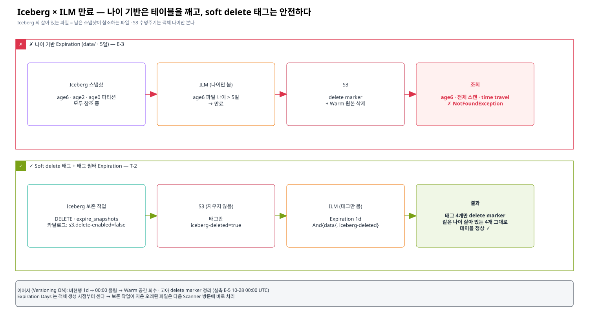

# 04. Iceberg × ILM 만료 충돌과 해결 — Soft delete 태그

> 이 문서의 목표: "ILM 으로 지우면 왜 Iceberg 가 깨지는가" 를 구조적으로 이해하고, **ILM 이 Iceberg 가 지운 파일만 지우게 하는 방법**(soft delete 태그)을 운영에 넣을 수 있게 한다.
> 근거: ✅ E-3(충돌 재현) · E-4(Iceberg 보존 작업) · E-5(Warm 최종 삭제) · **T-2(soft delete 태그)** — corp 테스트베드
> 관련: [14장 01 §6 기한 삭제](../14-ilm-config-guide/01-s3-bucket-setup.md#6-기한-삭제--iceberg-보존-작업--ilm-비현행-만료)

---

## 1. 왜 충돌하는가 — Iceberg 는 "어떤 파일이 살아 있는지" 를 메타데이터로 안다

```
metadata.json ─► manifest list(snap-*.avro) ─► manifest(*-m*.avro) ─► data/*.parquet
   (현재 스냅샷)       (스냅샷별 파일 목록)         (파일 경로 · 통계)        (실제 데이터)
```

- 테이블의 **살아 있는 파일 = 남아 있는 스냅샷들이 참조하는 파일 전부**다. "오래된 파일" 이 곧 "필요 없는 파일" 이 아니다.
  - 3일 전에 쓴 파일이라도 그 파티션이 아직 테이블에 있으면 현재 스냅샷이 참조한다.
  - 지운 지 오래된 파일이라도 time travel 보존 기간 안의 스냅샷이 참조할 수 있다.
- S3 수명주기 Expiration 은 **객체 나이만** 본다. 메타데이터를 읽지 않는다.

→ 나이 기반 Expiration 을 `data/` 에 걸면, **아직 참조되는 파일이 지워진다.**



### ✅ E-3 재현

| 단계 | 결과 |
|---|---|
| 테이블 `ilmexp.events` — 배치 age6 · age2 · age0 (파일 나이 6 · 2 · 0일) | 모두 조회 정상 |
| `data/` 에 Transition 1d + **Expiration 5d** | age6 파일 4개에 delete marker · Warm 원본 삭제 |
| 조회 | age0 · age2 ✅ / **age6 · 전체 스캔 · 가장 오래된 스냅샷 time travel ❌** `NotFoundException: Location does not exist` |
| 메타데이터 | data 파일 12개를 여전히 참조 — Iceberg 는 파일이 사라진 줄 모른다 |

장애가 **늦게 · 부분적으로** 드러난다는 점이 위험하다. 그 파티션을 읽지 않는 쿼리는 계속 성공한다.

## 2. 기본 해법 — 삭제 판단은 Iceberg 가 (✅ E-4 · E-5)

```sql
DELETE FROM t WHERE event_ts < now() - INTERVAL 5 DAYS;          -- 테이블에서 제외 (파티션 단위면 메타데이터만)
CALL system.expire_snapshots(table => 't', older_than => …);      -- 더 이상 참조 안 되는 파일을 S3 DELETE
```

Versioning ON 이면 S3 DELETE = delete marker + 원본은 **비현행 버전**으로 남는다 → ILM `NoncurrentVersionExpiration 1d` 가 비현행을 지워 Warm 공간을 회수한다.

✅ E-4/E-5: 보존 작업 후 테이블 정상, 지운 파일은 비현행 Warm 버전으로 남았다가 **10-28 00:00 UTC 이후 소멸**, delete marker 도 정리.

이 방식의 남은 불편:
- 삭제 I/O(파일 수만 건 DELETE)를 Spark 작업이 직접 한다 → 큰 테이블에서 `expire_snapshots` 가 오래 걸린다.
- "S3 에서 언제 지워지는지" 가 Spark 작업과 ILM 두 곳에 나뉜다.

## 3. 개선 해법 — Soft delete 태그 (✅ T-2)

Iceberg S3FileIO 에는 **파일을 지우는 대신 태그만 다는** 설정이 있다 (Iceberg AWS 문서 "S3 Tags").

| 설정 | 의미 |
|---|---|
| `s3.delete-enabled = false` | FileIO 삭제 요청 시 객체를 지우지 않는다 |
| `s3.delete.tags.<키> = <값>` | 대신 이 태그를 붙인다 |

그리고 ILM 은 **그 태그가 붙은 data 파일만** 만료한다.

```properties
# 보존 · 유지보수 작업이 쓰는 카탈로그
spark.sql.catalog.hive_maint.s3.delete-enabled                 = false
spark.sql.catalog.hive_maint.s3.delete.tags.iceberg-deleted    = true
```

```json
{"Rules": [
  {"ID": "tbl-softdel-expire", "Status": "Enabled",
   "Filter": {"And": {"Prefix": "db.db/tbl/data/", "Tags": [{"Key": "iceberg-deleted", "Value": "true"}]}},
   "Expiration": {"Days": 1}},
  {"ID": "tbl-r3-noncurrent", "Status": "Enabled", "Filter": {"Prefix": "db.db/tbl/data/"},
   "NoncurrentVersionExpiration": {"NoncurrentDays": 1}},
  {"ID": "tbl-r6-dm", "Status": "Enabled", "Filter": {"Prefix": "db.db/tbl/"},
   "Expiration": {"ExpiredObjectDeleteMarker": true}}
]}
```

### ✅ T-2 실측

| 단계 | 결과 |
|---|---|
| `tagt2.events` — 배치 old · new 각 4 파일, **모든 파일 나이 2일**로 소급 | STANDARD, 태그 없음 |
| 규칙 `And{tagt2.db/events/data/, iceberg-deleted=true}` Expiration 1d | |
| `hive_maint`(soft delete 카탈로그)로 `DELETE old` → `expire_snapshots` | Iceberg: 파일 4개 삭제 처리 · **S3: 지워지지 않고 태그 `iceberg-deleted=true`** |
| 약 10초 뒤 | **태그 붙은 4개만 delete marker**, 같은 나이의 살아 있는 4개는 그대로 |
| 조회 | 남은 new 배치 100,000행 · 전체 스캔 정상 |
| 이미 Warm 으로 전이된 객체에 태그 | 붙는다 · 읽기 정상 → Warm 파일도 같은 방식으로 정리 가능 |

```
DM        2026-10-28T00:36 event_ts_hour=2026-10-25-00/00000-11-…
STANDARD  2026-10-26T00:35 event_ts_hour=2026-10-25-00/00000-11-…  {'iceberg-deleted': 'true'}   ← 비현행 → R-3 이 정리
STANDARD  2026-10-26T00:35 event_ts_hour=2026-10-28-00/00000-28-…                                ← 살아 있는 파일, 그대로
```

## 4. 왜 안전한가 · 무엇이 남는가

| 질문 | 답 |
|---|---|
| ILM 이 살아 있는 파일을 지울 수 있나? | 태그가 없으면 대상이 아니다. 태그는 Iceberg 가 "참조 끝" 이라고 판단한 파일에만 붙는다 |
| 태그를 안 다는 엔진(Trino 등)이 지우면? | 그냥 삭제된다 — **안전한 쪽으로 실패** (지금과 같음) |
| `remove_orphan_files` 도 태그인가? | 같은 FileIO 삭제 경로라면 태그 🔍 (확인 필요) |
| 지운 파일이 S3 에 언제까지 남나? | Expiration Days 는 **태그 시점이 아니라 객체 생성 시점(mtime)** 부터 센다. 보존 작업이 지우는 파일은 보통 1일보다 오래됐으므로 **태그 후 첫 Scanner 방문**에 delete marker (T-2 는 10초). 이어서 (Versioning ON) 비현행 1d → 00:00 올림 → 방문. 합계 **약 1~2일 + Scanner** — 법적 삭제 시한이 있으면 이 합으로 맞춘다 |
| Expiration Days 를 1 로 두는 이유 | 만든 지 1일 안 된 파일(예: 실패한 커밋을 바로 정리)은 하루 유예 — 실수 복구 여지 |
| 바로 지워지지 않는데 용량은? | 그 기간만큼 Hot/Warm 에 남는다 (현재 방식도 비현행으로 1~2일 남음) |
| 태그 붙인 파일이 실수였다면? | Scanner 가 오기 전이면 태그를 지워 만료 대상에서 뺄 수 있고, 지난 뒤라도 Versioning ON 이면 비현행 1~2일 동안 버전이 남는다 (단, Warm 으로 전이된 파일은 F-1 때문에 복구 불가) |

## 5. 세 방식 비교

| | ① 나이 기반 Expiration | ② Iceberg 보존 작업 (현재 권장) | ③ ② + soft delete 태그 (개선) |
|---|---|---|---|
| 테이블 안전 | ❌ 깨짐 (E-3) | ✅ | ✅ |
| S3 삭제 주체 | ILM | Spark 작업 (DELETE 호출) | ILM (태그 보고) |
| 대규모 삭제 부하 | — | Spark 작업 시간 · S3 DELETE 폭주 | S3 백그라운드 (Scanner) |
| 실수 복구 여지 | 없음 | 비현행 1~2일 (Versioning ON) | Scanner 방문 전 태그 제거 + 비현행 1~2일 |
| 필요한 것 | — | 보존 작업 | 보존 작업 + 카탈로그 설정 + 태그 규칙 |
| 위험 규칙 검사 | 막아야 함 | 해당 없음 | `00-apply-ilm.sh` 가 지금은 막음 → 태그 필터 `iceberg-deleted` 예외 추가 필요 (후속) |

## 6. 엔지니어에게 확인할 것

- Q-I3 태그 필터 Expiration 을 대규모로 쓸 때 비용 · 주의점, 태그 변경이 많을 때 영향
- Q-I8 (관련) Versioning ON 에서 **전이된 current 버전이 만료되면 Warm 원본이 즉시 지워지고 비현행 기록만 남는 동작** — soft delete 로 Warm 파일을 만료할 때도 같음. 버전 복구가 안 된다는 뜻 (✅ F-1)
- Q-T6 Warm 쪽 실제 삭제(tier journal) 지연 · 실패 재시도 · 확인 방법
