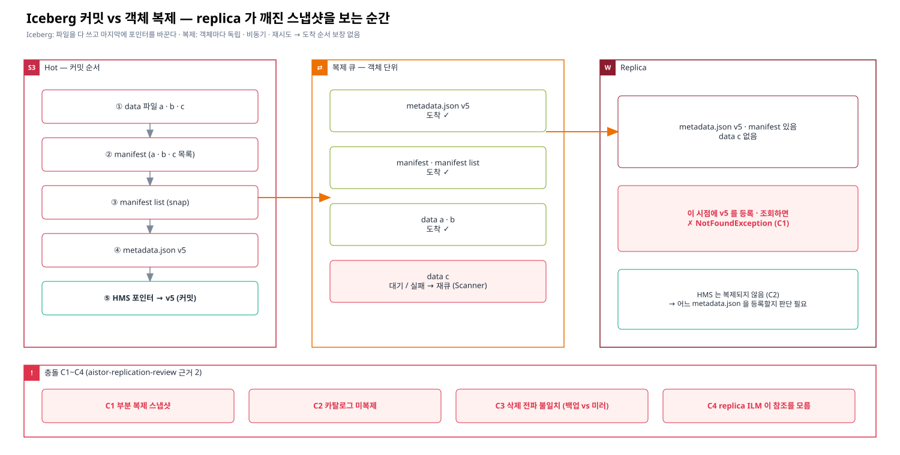
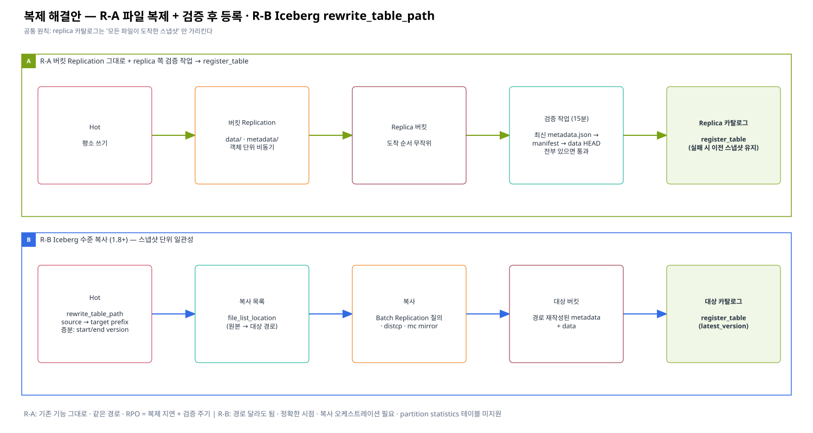

# 05. Iceberg × Replication 충돌과 해결 방향

> 이 문서의 목표: 버킷 복제(Replication)로 Iceberg 테이블을 복제하면 **왜 replica 쪽 테이블이 깨질 수 있는지** 를 커밋 구조로 이해하고, 해결 방향 세 가지와 ILM · 태그 정책과 함께 쓸 때의 주의점을 정리한다.
> 근거 등급: 이 문서는 **설계 · 공식 문서 기반** 이다 (Replication 은 이번 테스트베드에서 실측하지 않음).
> 기존 검토: [aistor-replication-review — 근거 2 Iceberg vs Replication (C1~C4) · 복제 → 검증 → 등록](../../aistor-replication-review/02-evidence/02-iceberg-snapshot-vs-replication.md) · [공식 인용 I3 (register_table · rewrite_table_path)](../../aistor-replication-review/02-evidence/06-official-reference-links.md)

---

## 1. 원자성 단위가 다르다

| | Iceberg | 버킷 Replication |
|---|---|---|
| 원자 단위 | **커밋 = 스냅샷** (여러 파일이 한꺼번에 "보이게" 됨) | **객체 하나** |
| 순서 | data 파일 → manifest → manifest list → metadata.json → 카탈로그 포인터(HMS) 순으로 쓰고, 마지막 포인터 교체 순간이 커밋 | 객체마다 독립 · 비동기 큐 · 재시도 |
| 카탈로그 | HMS 의 `metadata_location` 이 "현재 테이블" | 버킷 밖(HMS)은 복제 대상이 아님 |

Iceberg 는 "파일을 다 쓴 다음 포인터를 바꾸는" 방식으로 일관성을 만든다. 복제는 그 순서를 모르고 **객체가 도착하는 대로** replica 에 놓는다.



## 2. replica 에서 생기는 상황 (C1~C4 요약)

| # | 상황 | 결과 |
|---|---|---|
| C1 부분 복제 스냅샷 | metadata.json · manifest 는 도착했는데 data 파일 일부가 아직 큐에 있음 (또는 실패 후 재큐 대기) | replica 에서 그 스냅샷을 열면 `NotFoundException` — 이번 E-3 와 같은 증상 |
| C2 카탈로그 미복제 | HMS 는 복제되지 않음 | replica 테이블을 쓰려면 별도 카탈로그에 등록해야 함 — 무엇을 등록할지(어느 metadata.json) 판단 필요 |
| C3 삭제 전파 불일치 | Hot 의 `expire_snapshots` · `remove_orphan_files` 삭제가 delete marker 복제 설정에 따라 replica 에 반영 · 미반영 | replica 를 백업으로 쓰면 지워지면 안 되고, 미러로 쓰면 지워져야 함 — 목적에 따라 반대 |
| C4 ILM 이 참조를 모름 | replica 쪽에 ILM 만료를 걸면 replica 테이블이 깨짐 | [04](./04-iceberg-soft-delete.md) 와 같은 문제 |

추가로 Scanner 가 느리면 실패한 복제의 재큐잉도 늦어져 **C1 상태가 길게 지속**된다 ([01 §2 ④](./01-scanner-internals.md#2-scanner-가-한-객체에서-하는-일)).

## 3. 해결 방향



### R-A. 파일은 복제로, 커밋은 검증 후 등록 (기존 검토의 "복제 → 검증 → 등록")

```
Hot  : 평소대로 쓰기 ──(버킷 Replication: data/ · metadata/ 전부)──► Replica 버킷
Replica 쪽 검증 작업 (주기, 예: 15분)
  1. replica 버킷의 metadata/ 에서 최신 *.metadata.json 후보를 찾는다
  2. 그 스냅샷의 manifest list → manifest → data 파일 경로를 전부 HEAD 로 확인
  3. 모두 있으면 replica 카탈로그에 register_table (또는 기존 등록의 metadata_location 갱신)
     하나라도 없으면 이전에 검증된 스냅샷 유지 → 다음 주기 재시도
```

| 장점 | 단점 |
|---|---|
| 기존 버킷 복제 기능 그대로 | 검증 작업을 만들어야 한다 (파일 수만큼 HEAD) |
| replica 카탈로그는 **항상 완전한 스냅샷**만 가리킴 | RPO = 복제 지연 + 검증 주기 |
| 경로가 같아(버킷명만 다름) 재작성 불필요한 구성이면 단순 | 버킷명이 다르면 경로 재작성 필요 → R-B |

### R-B. Iceberg 수준 복사 — `rewrite_table_path` (Iceberg 1.8+)

```sql
-- Hot 쪽에서: 대상 위치 기준으로 메타데이터를 다시 쓰고, 복사할 파일 목록을 만든다
CALL hive_prod.system.rewrite_table_path(
  table          => 'db.tbl',
  source_prefix  => 's3://warehouse/db.db/tbl',
  target_prefix  => 's3://warehouse-dr/db.db/tbl',
  start_version  => '<지난번 복사한 metadata.json>',   -- 증분
  end_version    => '<이번 metadata.json>');
-- 결과: file_list_location (원본 → 대상 경로 목록 CSV) · latest_version
-- 1) 목록대로 복사 (Batch Replication · distcp · mc mirror)  2) 대상 카탈로그에서 register_table
```

| 장점 | 단점 |
|---|---|
| **스냅샷 단위 일관성** — 목록에 있는 파일이 다 복사된 뒤 등록 | 복사 작업 · 오케스트레이션 필요 |
| 경로(버킷명 · 클러스터) 달라도 됨 | partition statistics 파일이 있는 테이블 미지원 (I3) |
| Versioning 불필요 (🔍 Batch Replication 요구 조건 확인 — Q-R5) | Iceberg 1.8+ (현재 1.9.0 OK) |

### R-C. 복제 순서 조정 (보조)

`metadata/` 를 `data/` 보다 늦게 복제하면 C1 창이 줄어든다. 그러나 객체 복제는 재시도 · 병렬 때문에 **순서 보장이 아니라 확률 개선**일 뿐이다. 단독 해법으로는 쓰지 않는다. ❓ prefix 별 복제 우선순위 · 지연 설정 (Q-R4)

### 선택 기준

| 목적 | 권장 |
|---|---|
| 같은 경로 · 백업 성격 · 기존 복제 활용 | R-A |
| 다른 버킷 · 다른 클러스터 · 정확한 시점 복제 | R-B |
| 둘 다 | 평소 R-A, 주기적 정합 스냅샷은 R-B |

## 4. 복제와 ILM 을 같은 객체에

| 순서 문제 | 설명 | 대응 |
|---|---|---|
| 복제 전에 전이 | 아직 복제 안 된 객체가 Warm 으로 가면, 복제는 Warm 에서 읽어 와야 한다 | Days ≥ 복제 최대 지연 · ❓ 복제 PENDING 객체는 전이를 건너뛰는지 (Q-R1) · 전이 객체 복제 방식 (Q-R2) |
| 만료 전파 | Hot 의 ILM 만료(DM)가 replica 로 갈지 | delete marker 복제 설정 — 목적(백업/미러)에 맞춰 |
| replica 쪽 ILM | replica 에도 ILM 을 걸면 C4 | replica 에는 비현행 정리만, current Expiration 금지 |
| resync | Tier 가 연결된 버킷에서 resync 시 동작 | ❓ Q-R6 (기존 검토: tier 연결 단절 위험) |

## 5. 태그 기반 정책과 복제

[03 태그 기반 전이](./03-tag-based-tiering.md) · [04 soft delete](./04-iceberg-soft-delete.md) 를 쓰면 **태그가 정책의 일부**가 된다. 복제 시 태그가 따라가는지가 중요하다.

| 태그 | replica 에 복제되면 | 결정할 것 |
|---|---|---|
| `ilm-tier=warm` | replica 쪽에도 같은 규칙이 있으면 replica 도 즉시 전이 | replica 의 tier 구성 여부 |
| `iceberg-deleted=true` | replica 쪽 같은 규칙이 있으면 replica 에서도 만료 | replica 가 백업이면 **같은 규칙을 두지 않는다** |
| 나중에 붙인 태그(PutObjectTagging) | ❓ 태그 변경이 복제되는지 · 설정 (Q-R3) | soft delete 태그는 "나중에 붙는" 태그다 |

## 6. 엔지니어에게 확인할 것

- Q-R1 복제 PENDING · FAILED 객체를 전이 · 만료가 건너뛰는지
- Q-R2 전이된 객체를 복제할 때 Warm 에서 읽어 보내는지, replica 쪽에 어떤 형태로 저장되는지
- Q-R3 태그 변경 · delete marker 복제 설정과 기본값
- Q-R4 prefix 별 복제 우선순위 · 지연
- Q-R5 Batch Replication 이 Versioning 을 요구하는지, `rewrite_table_path` 의 파일 목록으로 Batch 작업을 만들 수 있는지
- Q-R6 Tier 연결 버킷의 resync 동작
