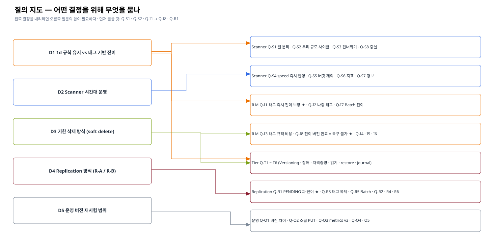

# 06. 질의 해설 — 왜 묻고, 답에 따라 무엇이 달라지나

> 이 문서의 목표: [14장 05 질의 목록](../14-ilm-config-guide/05-aistor-engineer-qna.md#4-엔지니어-질의-목록)의 각 질문을 **배경 · 왜 묻나 · 답에 따른 결정**으로 풀어, 현장에서 답을 듣고 바로 판단할 수 있게 한다.
> 질의 순서 추천: ① Q-S1 · Q-S2 · Q-I1 (방향 결정) → ② Q-I8 · Q-R1 (위험) → ③ 나머지
> 각 질문 끝의 **메모** 칸은 현장에서 채운다.

---

## Scanner

### Q-S1. Scanner 한 루프의 일과 분리 조절

| 항목 | 내용 |
|---|---|
| 질문 | Scanner 가 한 번 방문할 때 하는 일(ILM · 사용량 집계 · healing 점검 · 복제 점검 · 쿼터)을 각각 끄거나 주기를 따로 줄 수 있나? |
| 배경 | ILM 만 빨리 돌리고 싶어도 속도를 올리면 나머지도 같이 빨라진다 ([01 §2](./01-scanner-internals.md#2-scanner-가-한-객체에서-하는-일)). `fastest` 유휴 CPU 6배 (✅) |
| 답이 "가능" | ILM 위주 사이클을 짧게, healing · 사용량은 길게 → **[02](./02-scanner-load-reduction.md) C 안의 효과가 커짐** |
| 답이 "불가" | [03](./03-tag-based-tiering.md) 태그 기반 전이(ILM 을 Scanner 밖으로)의 우선순위가 올라간다 |
| 메모 | |

### Q-S2. 우리 규모의 사이클 시간

| 항목 | 내용 |
|---|---|
| 질문 | 객체 <N>억 · 평균 버전 <M> · 노드 <K> · 드라이브 <D> 규모에서 `default` 한 사이클이 얼마나 걸리나? 비슷한 고객 사례는? |
| 배경 | 테스트베드 단일 노드 기본 4.5 객체/s (✅). ILM 반응 시간 = Days + 00:00 올림 + **사이클 길이** |
| 판단 | 사이클 ≤ 수 시간 → 1d 규칙 그대로 운영 가능 / ≥ 1일 → 1d 규칙의 실제 지연이 2~3일 → 태그 기반 전이 또는 Days 재설계 |
| 준비 | 방문 전 현재 클러스터의 객체 수 · 버전 수 (`mc du --versions`, 사용량 메트릭) 를 뽑아 간다 |
| 메모 | |

### Q-S3. 변경 없는 폴더 건너뛰기

| 항목 | 내용 |
|---|---|
| 질문 | 바뀌지 않은 폴더를 건너뛰는 방식(변경 추적)은? 몇 사이클마다 전체를 다시 보나? 운영 버전에서 동작이 바뀌었나? |
| 배경 | Iceberg 의 지난 파티션은 거의 바뀌지 않는다 (append-only). 건너뛰기가 잘 되면 정적 데이터의 비용이 작다 — 그러나 **건너뛴 폴더의 ILM 만기도 늦게 처리**될 수 있다 |
| 판단 | 전체 재방문 주기 × 사이클 = 정적 폴더의 ILM 최악 지연 → Days 설계에 반영 |
| 메모 | |

### Q-S4. 속도 설정의 즉시 반영 · 스케줄

| 항목 | 내용 |
|---|---|
| 질문 | `scanner speed` 변경이 재시작 없이 즉시 반영되나? 진행 중 사이클에도? 노드별로? 공식 시간대 스케줄 기능은? |
| 배경 | [02 §4](./02-scanner-load-reduction.md#4-c--시간대별-속도) 시간대별 운영안은 즉시 반영이 전제 |
| 판단 | 즉시 반영 → CronJob 으로 시간대 운영 / 미반영 · 재시작 필요 → 시간대 운영 포기, 고정 `default` |
| 메모 | |

### Q-S5. 버킷 · prefix 단위 제외 · 우선순위

| 항목 | 내용 |
|---|---|
| 질문 | ILM · 복제가 없는 버킷을 Scanner 대상에서 빼거나 우선순위를 낮출 수 있나? |
| 판단 | 가능 → ILM 대상 테이블을 별도 버킷으로 모으는 설계 / 불가 → 버킷 분리의 이점은 관리 편의뿐 |
| 메모 | |

### Q-S6. 사이클 진행률 · 소요 지표

| 항목 | 내용 |
|---|---|
| 질문 | 한 사이클의 시작 · 끝 · 진행률 · 소요 시간을 보여 주는 지표(v3 metrics 이름)와 진단 명령은? |
| 배경 | 지금은 `objects_scanned` 기울기 · `bucket_scans_*` 로 추정만 한다 ([01 §7](./01-scanner-internals.md#7-관측-지표)) |
| 판단 | 대시보드 · 경보("사이클 > 24h") 설계 |
| 메모 | |

### Q-S7. 과다 버전 · 폴더 경보

| 항목 | 내용 |
|---|---|
| 질문 | `alert_excess_versions`(100) · `alert_excess_folders`(50,000) 경보는 어디로 나오나(로그 · 메트릭 · 웹훅)? 권장값은? |
| 배경 | Versioning × Iceberg 는 버전이 쌓이기 쉽다 — 조기 감지 수단 |
| 메모 | |

### Q-S8. 증설과 처리율

| 항목 | 내용 |
|---|---|
| 질문 | pool · erasure set · 노드를 늘리면 Scanner 가 병렬로 더 빨리 도나? |
| 판단 | 비례 → 증설이 ILM 반응 시간 개선 수단 / 비례 아님 → 대상 축소 · 태그 기반 전이로 |
| 메모 | |

## ILM · 태그

### Q-I1. 태그 필터 + 0d 의 PUT 즉시 전이 (가장 중요)

| 항목 | 내용 |
|---|---|
| 질문 | `And{Prefix, Tag}` + Transition 0d 규칙에서 태그를 붙여 PUT 하면 즉시 전이되는 것이 **공식 · 보장 동작**인가? 즉시 작업 큐의 작업자 수 · 대기열 한도는? 넘치면(`missed_immediate_tasks`) Scanner 가 다시 줍나? |
| 배경 | ✅ T-1: 같은 초에 전이. 이것이 [03](./03-tag-based-tiering.md) 제안의 전제 |
| 답이 "보장 + 넘치면 Scanner 가 처리" | 태그 기반 전이 도입 (안전망 규칙과 함께) |
| 답이 "최선 노력 · 넘치면 유실" | 안전망 규칙 필수 · compaction 병렬도 제한 · 놓친 건 감시 |
| 답이 "비권장" | 1d 규칙 + Scanner 튜닝으로 돌아감 |
| 메모 | |

### Q-I2. 나중에 붙인 태그

| 항목 | 내용 |
|---|---|
| 질문 | PutObjectTagging 은 수명주기 재평가를 하지 않는가 (✅ 관측: 즉시 전이 안 됨)? 의도된 동작인가? 즉시 평가 옵션은? |
| 판단 | 옵션이 있으면 "지난 파티션에 태그만 다는" 가벼운 방식 가능 (파일 재작성 불필요) |
| 메모 | |

### Q-I3. 태그 필터 규칙의 대규모 비용

| 항목 | 내용 |
|---|---|
| 질문 | 태그 필터 Transition · Expiration 을 수억 객체에 쓸 때 비용(태그 읽기) · 주의점? soft delete 처럼 태그 변경이 많을 때? |
| 메모 | |

### Q-I4. 00:00 UTC 올림

| 항목 | 내용 |
|---|---|
| 질문 | 만기를 다음 00:00 UTC 로 올리는 기준을 바꾸거나 분산시키는 옵션이 있나? |
| 배경 | KST 09:00 (업무 시작)에 하루치 만기가 몰린다 ([02 §5](./02-scanner-load-reduction.md#5-자정-쏠림-다루기)) |
| 메모 | |

### Q-I5. 규칙 수

| 항목 | 내용 |
|---|---|
| 질문 | 버킷당 규칙 수 한도 · 규칙이 많을 때 평가 비용 (테이블별 규칙 수백 개)? |
| 배경 | 테이블마다 R-1/R-3/R-6 (+ 태그 규칙) → 테이블 100개면 400개 |
| 판단 | 한도가 낮으면 prefix 를 상위로 묶는 설계 (예: `warehouse/hot-tables/…`) |
| 메모 | |

### Q-I6. `NewerNoncurrentVersions`

| 항목 | 내용 |
|---|---|
| 질문 | 지원 여부 · `NoncurrentDays` 와 함께 쓸 때 동작 |
| 판단 | 버전 수 상한을 걸어 Scanner 비용을 묶을 수 있음 |
| 메모 | |

### Q-I7. Batch 전이

| 항목 | 내용 |
|---|---|
| 질문 | Batch 프레임워크에 expire 외 **transition** 작업이 있나? (Scanner 없이 prefix 일괄 전이) |
| 판단 | 있으면 태그 방식 없이 "매일 지난 파티션 일괄 전이" 가능 — 가장 단순한 대안 |
| 메모 | |

### Q-I8. 전이된 버전 만료 시 Warm 원본 즉시 삭제 (위험)

| 항목 | 내용 |
|---|---|
| 질문 | Versioning ON 에서 **Warm 으로 전이된 current 버전이 만료되면 Warm 원본은 즉시 지워지고 비현행 기록만 남아 GET 이 실패**한다 (✅ F-1). AIStor 에서도 같은가? 의도인가? |
| 배경 | 일반 덮어쓰기로 비현행이 된 전이 버전은 읽힌다 (✅). 만료 경로만 다르다 |
| 의미 | Warm 에 있는 데이터는 **버전 기반 복구가 안 된다** → 실수로 만료되면 복구 불가. soft delete · 보존 정책 설계에 반영 |
| 메모 | |

## Tier (Warm)

| # | 질문 | 왜 · 판단 | 메모 |
|---|---|---|---|
| Q-T1 | Warm tier 버킷에 Versioning · Object Lock · 복제를 걸어도 되나? 권장은? | 테스트는 Versioning OFF. 규칙은 절대 걸지 않는다 (stub 만 남음) | |
| Q-T2 | Warm 장애 시 Hot 동작 — 전이 객체 GET 오류 형태 · 타임아웃 · 전이 작업 재시도/적체 | 개발자 안내(14장 04 FAQ) 의 🔍 항목. 장애 시험 계획에 반영 | |
| Q-T3 | tier 자격증명 교체 절차 (`mc ilm tier edit`) · 무중단? | 운영 보안 정책 (주기 교체) | |
| Q-T4 | 전이 객체 읽기 최적화 — Hot 캐시 · 범위 읽기 · 병렬 | Parquet 은 footer → column chunk 범위 읽기. 요청당 지연(✅ 291 → 590 ms)이 주 비용 | |
| Q-T5 | 전이 객체를 Hot 으로 되돌리는 권장 방법 (restore · 재기록) | 정책 변경 · 핫 데이터 재사용 시 | |
| Q-T6 | Warm 실제 삭제(tier journal)의 지연 · 실패 재시도 · 확인 지표 | 공간 회수 확인 — 테스트에서는 `expiry_missed_tierjournal_tasks` 0 (✅) | |

## Replication

| # | 질문 | 왜 · 판단 | 메모 |
|---|---|---|---|
| Q-R1 | 복제 PENDING · FAILED 객체를 전이 · 만료가 건너뛰나? | 건너뛰면 Days 를 짧게 둬도 안전 / 아니면 Days ≥ 복제 지연 ([05 §4](./05-iceberg-replication.md#4-복제와-ilm-을-같은-객체에)) | |
| Q-R2 | 전이된 객체를 복제할 때 Warm 에서 읽어 보내나? replica 쪽 저장 형태는? | 복제 트래픽 · Warm 부하 | |
| Q-R3 | 태그 변경 · delete marker 복제 설정과 기본값 | 태그 기반 정책 · soft delete 가 replica 에 번지는지 ([05 §5](./05-iceberg-replication.md#5-태그-기반-정책과-복제)) | |
| Q-R4 | prefix 별 복제 우선순위 · 지연 | R-C (metadata/ 늦게) 가능 여부 | |
| Q-R5 | Batch Replication 의 Versioning 요구 · `rewrite_table_path` 파일 목록으로 작업 생성 | R-B 실현 방법 | |
| Q-R6 | Tier 연결 버킷의 resync 동작 | 기존 검토: tier 연결 단절 위험 | |

## 버전 · 운영

| # | 질문 | 왜 · 판단 | 메모 |
|---|---|---|---|
| Q-O1 | 운영 버전(Hot 2026-02-07 · Warm 2026-06-06)에서 위 동작 차이 · 권장 업그레이드 | 테스트는 MinIO 2024-10 — 결과 이전 가능성 판단 | |
| Q-O2 | `X-Minio-Source-Mtime` 소급 PUT 이 AIStor 에서 동작하나? (시험 전용) | 폐쇄망 runbook E-0 — 안 되면 실시간 검증으로 | |
| Q-O3 | metrics v2 → v3 이름 대응 · 인증 · 권장 대시보드 | 모니터링 구성 | |
| Q-O4 | 사용량 집계에서 전이 객체 표시 (Hot · Warm · 논리 크기) | 용량 리포트 — `mc ls` 크기는 논리 크기 (✅) | |
| Q-O5 | 감사 로그에서 tier 계정 요청 식별 · Warm 접근 통제 권장 | J-7 운영화 | |

## 현장 정리 틀

| 결정 | 근거 질의 | 결론 | 후속 |
|---|---|---|---|
| 1d 규칙 + Scanner 기본 유지 vs 태그 기반 전이 도입 | Q-S1 · Q-S2 · Q-I1 · Q-I7 | | |
| Scanner 시간대 운영 | Q-S4 | | |
| 기한 삭제 방식 (보존 작업 vs + soft delete) | Q-I3 · Q-I8 | | |
| Replication 방식 (R-A / R-B) | Q-R1 · Q-R3 · Q-R5 | | |
| 운영 버전 재시험 범위 | Q-O1 · Q-O2 | | |
